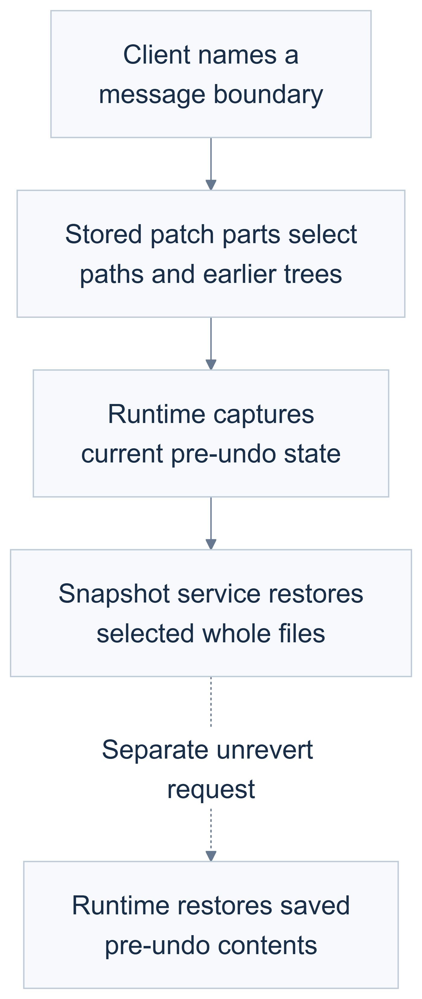
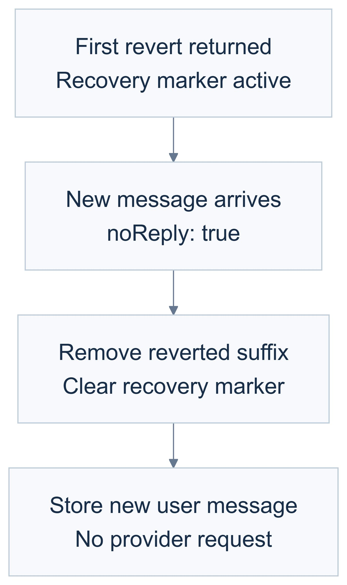

# Recovery figures

The figures show the selected successful ordinary-session path on the pinned baseline. They omit failure branches and do not establish atomic rollback or ownership of later edits.

## Selected file restoration

First revert replaced the later edit in the selected helper. A separate unrevert request recovered the captured pre-undo contents in the recorded fixture, before any intervening write or new message. Inspect files independently after each operation. Unrevert can restore more than the selected patch paths.

[Editable Mermaid source](01-recovery-domain.mmd) · [SVG](01-recovery-domain.svg) · [Open in Mermaid Live](https://mermaid.live/edit#pako:eNptVE1vm0AQ_Sur7dV2-bCzBFWRYqc9tZcmaqWWHpbdAVYBlg6L8-H4v3cAY-EqHMx65s2bN8ODA1dWA495VtonVUh07GGbYFIzum5_J3xXGqgdq2UFLZOfUvx4Q6dW5sBS29Va4kvC_5wr2HJ5w7ZUd-8sgmaNdKqgX3Qta6EE5QYKChdEV2sGEqkDMocA7YxpOzDtiOl7VztTAVOycR1COxCoDrHX1SAsSYVlrZMOZvW7of6uV1LLpi2so_64NwoYcfTiRqJRFCl9KmwJLDPlhYw7tlwtb96IBWgIasG6GmEPtCeEvx0xJfyNfZ7JnNhZK_egx2knkcrWjlRPDfiC52g0jzNZtrDgFWAl-__8MPZPuCugorFiOqaypdNiypTWPo4JVcq2NWqWG6p-SDQyHcaJ2WEaKOEZifgiK1O-jOW3BCvPxRPi3rye-gZe83yRbtBU9Nh3trQ4Qj5kIrvO1HuoB3h2c6QvAr2O3kNuLWrAOTZVKtXiAluaGuaQqysRRdkFBHQOX2UK5Vaqxxx7k04qhyvhI_Z4XtfZ-_9tiky2Py2h7yvxok9NL859I5Wp8x6z3sxyKOvHWS6c5xqp9SnuR7P4E8qmocRPo10xVAXeSWl_O5JbGln_srbiscOO_EKz5cXZPV2jyZ93RuYoq3OU3pJhq-ROHgt_4ODxgT_z2BdiFYTX1yIMg0BsPHG14C8U9r3VOvLDaLPeRML3gs1xwV-Htt5KBKG_9jahEGEULWjXhsz-bfyEDF-S4z-uzGIK)

## New-message cleanup

This separate follow-on left the reverted files unchanged. It checks the no-reply path, not provider-backed continuation or erasure of every historical object.

[Editable Mermaid source](02-continuation.mmd) · [SVG](02-continuation.svg) · [Open in Mermaid Live](https://mermaid.live/edit#pako:eNptU0uPmzAQ_iuWe2VTHiEmqFppk9We2j0kq1Zq6cHBA7ECNh1MHhvlv695JCLV-gLM95iP0fhMUy2AxjQr9CHdcjTkbZFgoog9T38S-iKxNgRhD9g-TIMKxLcNfn1cQapt9URKjjtAwlMj95DQvzc5eXh4JAtr8goHUkJd8xwIR7S0urNQegVVcYqJwWasXHTKpVWuoLRNhv4gSN1kmTx24mUBHC1yl2JksuxMnq3J2mgEomyIprZBhySdyasmFeq9FNBa_WugNoMFdWiOUtA440UNDi0BS95-03PfIaFmC6WNHdvXDa_tm3NFCq13PZAWvK5lOsI61U-Okm8KqFvW-Ro5oZlW5oWXsjj18idLK27iK2Mt34e-vlsd7-AKpZ3EaakLjT3lS8ayeZZ-xnqDoxkzPeaLafQZc6HRjmjM3aTpRrA7biEVjCmzGYui7I4CIofvfAPFgqe7HHWjxDVldxLacy-3cd0W879JpQ3uhyG0fTne9VF2q9cVT6XKW840HGHI1W6EBWOs4kIMdS8a1Q_Iq8oCv6Qw207lu0PS9nGx21Jx9VvrksbtMjvU_lu-vW1PUwlu4FnyHHl5qyKobqqNMjRmYedB4zM90thjbOIH8zkLAt9noctmDj3ZsudOppEXROE0jJjn-uHFoe9dW3fC_MCbumHAWBBFjp21tIv_o7_f3TW_fACaUj8h)

Both diagrams were rendered in Mermaid Live Editor v12.2.0 with the supplied [configuration](mermaid-config.json). PNGs were produced from its rendered SVG using Chrome. The SVG viewport was normalized for export, with diagram labels and geometry preserved. Both PNGs were inspected at 354 CSS pixels, within a 390-pixel phone viewport.
